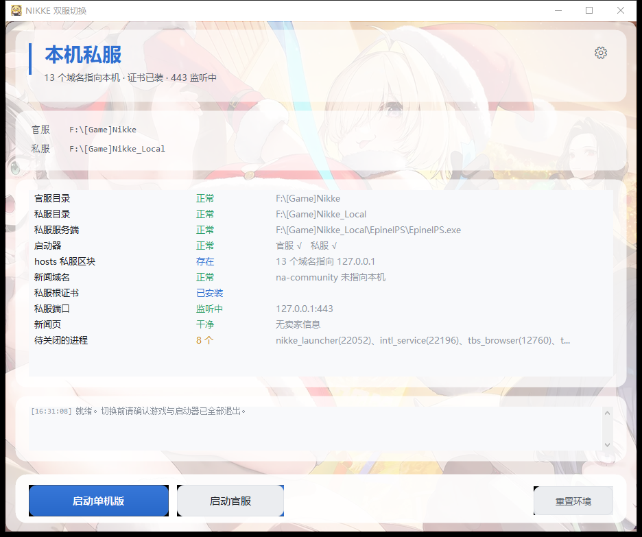

# NikkeDualClient · NIKKE 双服切换

官服 / 本机私服一键切换的 Windows 客户端。自包含单文件，目标机器不需要装 .NET 运行时。



## 解决什么问题

私服和官服不能同时在线，切换要动 hosts、装/卸根证书、起停本地服务。手动操作容易残留，也难还原干净。这个工具把它收敛成两个按钮：

| 点击 | 工具做的事 |
|---|---|
| 启动单机版 | 体检 → 缺什么补什么 → 起本地服务 → 开启动器 |
| 启动官服 | 体检 → 清私服残留 → 开官服启动器 |

顺带处理私服包常见的两个坑：启动器新闻页被换成卖家广告、换机器后路径失效。

## 构建

需要 .NET 10 SDK：

```bat
dotnet publish NikkeDualClient.csproj -c Release -o .\publish
```

产物是自包含单文件 exe（约 48 MB），双击即用，会弹 UAC 提权（要改 hosts 和本机证书库）。

图标 `Assets\app.ico` 是预生成的七个尺寸（16~256），源图是同目录的 `app-icon.png`。

---

## 界面

配色对齐 `NIKKE_GM`：中性灰黑分三层（窗口 `#1A1A1A` / 卡片 `#232323` / 底部 `#141414`），强调色 `#2F6FD0`，微圆角，标题栏通过 DWM 走深色模式。

**背景**：右上角齿轮 → 外观。原图直接 cover 铺满，**不做模糊**，靠压暗层保证文字可读。

- 图按 **cover 等比裁剪**铺满，不做拉伸 —— 竖版壁纸硬拉成横版会把人压扁
- 裁切靠**直接拖预览框**：拖动平移、滚轮缩放、双击复位，比滑块直观，也不用算百分比
- 预览框比例和主窗口一致（1.25:1），所以框里就是最终效果
- 压暗滑块是文字可读性的最后一道保险，背景越花哨越要拉高
- 只在窗口尺寸变化结束时重算，拖动窗口过程中不重绘

**图标**：`Assets\app.ico` 由 `Assets\app-icon.png` 生成（16/24/32/48/64/128/256 七个尺寸）。`ApplicationIcon` 写进 exe 的 Win32 资源，同时用 `EmbeddedResource` 暴露给窗体 —— 不用 `Icon.ExtractAssociatedIcon`，因为单文件发布会解压到临时目录，按路径找不到原 exe。

**卡片与按钮**：卡片圆角 16px（`GlassPanel.Radius` + `Region` 裁剪），按钮圆角 10px。按钮分两种填充：主按钮走上下 8 级的微渐变（有厚度），次要按钮走纯色 + 边框 —— 同色背景上的渐变底边会暗一档，看起来像接缝。

---

## 设置

点**右上角齿轮**进入，左侧导航五页：

| 页 | 内容 |
|---|---|
| 外观 | 背景图 + 显示方式（铺满裁切 / 等比留边 / 拉伸）+ 拖动裁切 + 压暗 |
| 路径 | 官服 / 私服根目录手动填或自动扫描，下方逐项校验关键文件是否就位 |
| 界面 | 浅色（默认）/ 深色 / 跟随系统，**关闭设置后立即生效，不重启** |
| 维护 | 手动修复新闻页、打开备份目录、打开服务日志 |
| 关于 | 版本、作者、参考来源 |

背景裁切是三层参数叠加：

```
BackgroundMode  决定基准比例（cover 取最大值、contain 取最小值、stretch 直接铺）
BackgroundZoom  100~300%，只在 cover 下起作用，相当于“在铺满的基础上再放大”
BackgroundPosX/Y  0~100，决定放大后框住哪一块（50 = 居中）
```

渲染统一走 `BackgroundRenderer.Render()`，**设置页的预览和主窗口用的是同一个方法**，所以预览就是最终效果，不存在“预览好看实际不对”。

主题跟随系统读的是 `HKCU\Software\Microsoft\Windows\CurrentVersion\Themes\Personalize\AppsUseLightTheme`，`0` 即系统深色。

---

## 关于 serverselectorsettings.json

原包里有个 `ServerSelector.Desktop.exe`（101 MB 的 Electron），作用是"选客户端目录"，写 `serverselectorsettings.json` 的 `GameRoot`。

**验证结论：EpinelPS 服务端不读这个文件。** 对 `EpinelPS.exe` 全文检索（UTF-16 和 UTF-8 两种编码），`serverselectorsettings` / `GameRoot` / `ServerSelector` 全部未命中；而且现有配置里 `GameRoot` 指向早已不存在的 `E:\[3]Nikke\NIKKEG`，游戏照样能跑。

所以这一步在技术上不是必需的。但为了兼容（旧选择器下次打开别显示错路径），`SelectorSync.WriteIfStale()` 会在启动单机时补一次：

- 只有现有 `GameRoot` **失效**（缺失或目录不存在）才写，不覆盖用户手选的路径
- 写之前把原文件备份到 `backup\serverselectorsettings_*.json`
- 路径从 `PrivateLauncherPath` 反推：`...\NIKKEG\Launcher\nikke_launcher.exe` → `...\NIKKEG`

---

## 换设备与授权（auth.txt）

`EpinelPS\auth.txt` 是卖家侧的激活凭证，内容就一行：

```
订单号=机器码
```

机器码取自本机 CPU 的 `ProcessorId`，**换一台机器必然不匹配**，启动时就会要求重新输入订单号。

工具**不读写**这个文件（`grep auth.txt` 在源码里零命中），切换服务端也不会改动它。但工具会**重启 EpinelPS**（切官服停服务、切私服起服务），而校验只在启动时跑一次——所以某台机器的授权本来就无效的话，重启之后才会暴露出来。

诊断报告（设置 → 维护 → 导出日志，或 `--diag`）里有这一段，订单号只保留前 4 位，文件可以放心转发：

```
=== 授权文件（EpinelPS\auth.txt）===
状态            存在，26 字节，改于 2026-10-29 08:41
订单号          maog***
绑定机器码      BFEBFBFF00090672
本机 CPU ID     BFEBFBFF000906EA
机器码匹配      否 —— 这个 auth.txt 不是本机激活的
```

排查换设备后要求激活的问题，先看「机器码匹配」这一行。

---

## 无感切换（v1.1 核心行为）

只有两个入口，点哪个就收敛到哪个，**不存在“先恢复再启动”这一步**：

| 点击 | 工具做的事 |
|---|---|
| 启动单机版 | 体检 → 缺 hosts 补 hosts / 缺证书装证书 / 新闻页脏就重写 / 服务没起就起 → 开启动器 |
| 启动官服 | 体检 → 有私服残留就停服务、还原 hosts、卸载证书 → 开官服启动器 |
| 重置环境 | 应急用，只清系统状态不启动客户端，藏在右下角小字里 |

进程分两类，这是能“无感”的关键：

- `EpinelPS.exe` 是工具自己起的后台服务 → **自动停、自动复用，不问用户**
- `nikke_launcher` / `nikke` / `tbs_browser` / `intl_service` 是用户正在用的 → 停下来提示，**绝不强杀**

已经完整在跑的时候点同一个按钮，工具什么都不做，只提示“已在运行”，不会重复折腾。

---

## 三个原始问题，现在怎么解的

### 1. 游戏版本更新后要不要重新处理

**不需要人工干预，工具每次启动会自动补。**

| 更新方式 | 覆盖内容 | 工具的行为 |
|---|---|---|
| EpinelPS 只换 EXE | `EpinelPS.exe` | 无影响。hosts / 证书是系统层，`wwwroot` 不动 |
| EpinelPS 整包覆盖 | `wwwroot\nikke_launcher\index.html` + `9.png` 被换回卖家页 | 点「启动单机版」时检测到 `newsPolluted = true`，自动重写 |
| 官服客户端更新 | `NIKKE\Launcher\*` | 无影响。工具只调 `launcher.exe` |
| 私服客户端更新 | `NIKKEG\*` | 无影响。若目录改名，点「重新定位」重新扫描 |

关键点：判断依据是**文件内容**不是版本号。`NewsRepair.IsPolluted` 直接查 HTML 里有没有 `taobao.com` / `毛哥` / `9.png` / `QQ群`，命中就重做，跟版本无关。

### 2. 不同设备目录不同

不认目录名，认**特征文件组合**：

```
<目录>\EpinelPS\EpinelPS.exe            → 私服根
<目录>\NIKKE\Launcher\nikke_launcher.exe → 官服根
```

`Locator.Scan()` 两步走：
1. 先试常见名（`[Game]Nikke`、`Nikke_Local`、`NIKKE`…），通常 1 秒内命中
2. 没命中就扫所有固定盘两层目录，跳过 `Windows` / `Program Files` / `Users` 等系统目录

两条都找不到，弹目录选择框让用户各点一次。选择结果写进配置，下次直接读。

路径都以「相对根目录」形式存在配置里（`NIKKEG\Launcher\nikke_launcher.exe`），换机器只改 root。

### 3. 之前手动移除的东西能不能一键做

能，全部收进 `EnvController`，且幂等（重复执行无副作用，每次都先备份）：

| 动作 | 实现 | 备份位置 |
|---|---|---|
| 摘 hosts 私服区块 | `HostsManager.Disable()`，只动 `# >>> NIKKE-PRIVATE-BEGIN` 到 `END` 之间 | `backup\hosts_*.bak` |
| 卸私服根证书 | `CertManager.Remove()`，按指纹精确匹配，不清库 | 证书库里删除 |
| 停本地服务 | `ServerRunner.Stop()`，只杀路径匹配的 EpinelPS | 无 |
| 新闻页去推广 | `NewsRepair.Repair()`，重写 HTML + 重算 `.gz` + 移走 `.br` + 清 WebView 缓存 | `backup\news_*\` |
| 移走推广图 | 同上，`9.png` 移出 `wwwroot` | `backup\news_*\9.png` |

「启动单机版」负责补齐私服侧那几项，「启动官服」负责清掉它们。用户不需要单独点一次“恢复”——`Restore()` 只留给右下角的「重置环境」和 CLI 的 `--restore` 兜底用。

---

## 命令行接口（给 GM 工具集成用）

WinExe 会自己 `AttachConsole` 到父进程，输出 UTF-8 JSON，可直接解析。

```bat
NikkeDualClient.exe --verify             &REM 输出状态 JSON
NikkeDualClient.exe --restore            &REM 恢复官服基线
NikkeDualClient.exe --repair             &REM 只修新闻页
NikkeDualClient.exe --start private      &REM 启动单机（含自愈）
NikkeDualClient.exe --start official     &REM 启动官服
NikkeDualClient.exe --scan               &REM 重新扫描目录并写配置
```

`--verify` 输出：

```json
{
  "ok": true,
  "mode": "private",
  "modeText": "本机私服（运行中）",
  "officialRoot": "F:\\[Game]Nikke",
  "privateRoot": "F:\\[Game]Nikke_Local",
  "hostsBlock": true,
  "newsHijacked": false,
  "caInstalled": true,
  "portOpen": true,
  "newsPolluted": false,
  "processes": [{ "Name": "EpinelPS", "Id": 4484 }]
}
```

退出码约定：`0` 官服基线，`1` 私服或中间态，`2` 出错。

`--start` 会多返回一个 `steps` 数组，记录这次实际做了什么（没做事时为空或只有一句“已在运行”），方便在 GM 工具里直接显示过程：

```json
{ "ok": true, "action": "start", "target": "official",
  "steps": ["正在清理私服环境：停止私服服务、还原 hosts、卸载证书",
            "  私服服务已停止（1 个进程）", "  hosts 已还原",
            "  私服根证书已卸载（1 张）", "已打开官服启动器"] }
```

GM 工具里加个「双服环境」页，调 `--verify` 渲染状态、调 `--start private` 起服即可。注意调用方进程要有管理员权限（工具自己是 `requireAdministrator`，会继承）。

---

## 两个必须记住的技术坑

### 一、进程不能挂在自己的作业对象下

第一版用 `Process.Start` 起 EpinelPS，结果很怪：日志显示「服务就绪 PID xxx」，关掉工具再打开，进程没了、443 不监听。

原因是父进程在作业对象（job object）里，会话结束时整棵树被 `KILL_ON_JOB_CLOSE` 带走。加了 `CREATE_BREAKAWAY_FROM_JOB` 也没用 —— 作业对象不允许脱离时那条路会静默回退。

最终改用 WMI 的 `Win32_Process.Create`：新进程的父进程是 `WmiPrvSE.exe`，不在调用方的进程树里，也不属于调用方的作业对象。

验证方法：`--start private` 返回后，隔一次会话再查 `Get-Process EpinelPS`，PID 应该还在、443 还在监听。

### 二、pem 里只有证书时不能用 CreateFromPemFile

`X509Certificate2.CreateFromPemFile(path)` 在第二个参数为 null 时会去**同一个文件**里找私钥。`myCA.pem` 只有 `CERTIFICATE` 块，于是抛：

```
The key contents do not contain a PEM, the content is malformed, or the key does not match the certificate.
```

改用 `X509Certificate2.CreateFromPem(text)`，只解析证书块。

---

## 开发与发布

```powershell
# 在项目根目录执行；临时目录指到项目盘，避免往 C 盘写缓存
$root = $PWD
$env:TEMP = "$root\临时"
$env:TMP = "$root\临时"
$env:DOTNET_CLI_HOME = "$root\临时\dotnet"
$env:NUGET_PACKAGES = "$root\临时\nuget"

dotnet build   NikkeDualClient.csproj -c Release
dotnet publish NikkeDualClient.csproj -c Release -o .\正式产物
```

产物是单文件 47 MB（自包含 + 压缩）。WinForms 不支持 `PublishTrimmed`，别开。

代码结构：

```
Program.cs              入口 + CLI 分发
Core/AppConfig.cs       配置（相对路径 + 首次发现后落盘）
Core/Locator.cs         特征文件扫描
Core/HostsManager.cs    hosts 标记区块（Latin1 字节透明读写）
Core/CertManager.cs     证书按指纹装卸
Core/Runtime.cs         进程扫描 / 端口 / 服务 / 客户端
Core/ProcessLauncher.cs WMI 创建进程（脱离作业对象）
Core/NewsRepair.cs      新闻页三层修复
Core/EnvController.cs   编排：Private / Official / Restore / Verify
Ui/MainForm.cs          界面
```

---

## 已知边界

- **两边不能同时在线。** hosts 和 443 是 Windows 级设置，拆目录解决不了。
- **EpinelPS 绑的是 `0.0.0.0:443`**，代码写死。不可信网络里要加防火墙规则，只放行本机。
- **`%APPDATA%\nikke_launcher` 没做 Junction 隔离。** 里面有登录库 `production_gl_launcher.db`，改成链接更容易串号。工具只在修新闻页时清 `Cache`/`Code Cache`/`GPUCache`，登录态不动。
- **进程不会被强杀。** 有客户端在跑就停下来提示用户关，强杀游戏可能丢进度。
